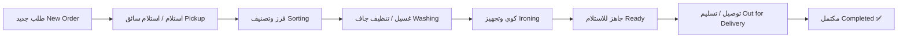

<div align="center">

# 🧺 LaundrySaaS Platform
### Multi-Tenant Cloud SaaS Solution for Laundry & Dry-Cleaning Management
**منظومة سحابية متكاملة متعددة المستأجرين لإدارة المغاسل والمصابغ وخدمات التوصيل**

[](https://dotnet.microsoft.com/)
[](https://abp.io/)
[](https://flutter.dev/)
[](https://angular.dev/)
[](https://www.docker.com/)
[](#license)

---

</div>

## 📌 نظرة عامة | Project Overview

**LaundrySaaS** هي منصة متقدمة من فئة **Software as a Service (SaaS)** صُممت خصيصاً لأتمتة وتشغيل وإدارة سلاسل ومغاسل الملابس الحديثة بأسلوب متعدد المستأجرين (**Multi-Tenancy**). توفر المنظومة حلاً شاملاً يربط بين إدارة الفروع ونقاط البيع (POS)، وتطبيقات الجوال المخصصة للمشغلين والعملاء والسائقين، مع دعم كامل للفوترة الإلكترونية وتتبع دورة حياة الغسيل لحظة بلحظة.

**LaundrySaaS** is an enterprise-grade multi-tenant SaaS platform engineered specifically for modern laundry, dry-cleaning businesses, and on-demand laundry delivery services. Built on top of **ABP Framework (.NET 10)** and modern cross-platform technologies (**Flutter & Angular**), it provides complete end-to-end automation from order intake and POS to garment tracking, driver dispatch, and customer delivery.

---

## 🚀 الميزات الرئيسية | Key Features

### 🏢 معمارية تعدد المستأجرين (Multi-Tenancy)
- عزل كامل للبيانات والاشتراكات لكل مستأجر (مغسلة أو سلسلة فروع).
- خطط اشتراك وباقات مرنة (`Editions` & `Subscriptions`).
- معالجة تلقائية للمستأجر عبر الدومين الفرعي (`subdomain`) أو الهيدر (`__tenant`).

### 📱 تطبيقات جوال مخصصة (Flutter Cross-Platform)
- **تطبيق إدارة المغسلة ونقطة البيع (Laundry Operator & POS App)**:
  - نقطة بيع سريعة للمستلمين في الفرع (Walk-in POS).
  - إدارة الخدمات وقوائم الأسعار (Catalog & Pricing).
  - تتبع مراحل غسيل الملابس خطوة بخطوة.
  - دعم الطباعة الحرارية للفواتير وتذاكر الملابس.
  - واجهة عربية بالكامل (RTL First) وتصميم حديث (Material 3).
- **تطبيق العملاء (Customer Mobile App)**:
  - طلب خدمات الغسيل والكوي والاستلام من المنزل.
  - تحديد المواقع الجغرافية والعناوين المفضلة.
  - تتبع حالة الطلب خطوة بخطوة والتنبيهات الفورية.
- **تطبيق السائقين ومنظومة التوصيل (Drivers App)**:
  - مهام استلام وتسليم الطلبات حسب المنطقة الجغرافية.
  - مسارات التوصيل وإثبات التسليم.

### 💻 لوحة التحكم والإدارة (Angular & Blazor Admin Portal)
- إدارة الفروع، المستأجرين، والأذونات وحركات النظام.
- تقارير تفصيلية ومؤشرات أداء رئيسية (KPIs) للإيرادات والطلبات.

---

## 🏗️ البنية المعمارية | Architecture & Tech Stack

```text
LaundrySaaS/
├── src/                               # النواة المشتركة وتطبيقات النطاق الرئيسي
│   ├── LaundrySaaS.Domain             # DDD Domain Entities, Value Objects, Logic
│   ├── LaundrySaaS.Application        # Use Cases, DTOs, Application Services
│   ├── LaundrySaaS.EntityFrameworkCore# EF Core DbContexts, Repositories, Migrations
│   ├── LaundrySaaS.HttpApi            # REST API Controllers
│   ├── LaundrySaaS.Web                # Razor / MVC Admin Shell
│   └── LaundrySaaS.Blazor*            # Blazor Server & WebAssembly Components
│
├── modules/                           # الوحدات الوظيفية النمطية (Modular Architecture)
│   ├── Laundries/                     # وحدة المغاسل، الفروع، والكتالوج + Laundry Mobile App
│   ├── Customers/                     # وحدة إدارة العملاء + Customer Mobile App
│   ├── Orders/                        # محرك دورة حياة الطلبات والفوترة
│   └── Drivers/                       # وحدة التوصيل والمناديب والمهام اللوجستية
│
├── host/                              # خوادم التشغيل والاستضافة (Microservices/Hosts)
│   ├── LaundrySaaS.AuthServer/        # خادم المصادقة وهوية المستخدمين (OpenIddict)
│   ├── LaundrySaaS.HttpApi.Host/      # بوابة الـ REST APIs الرئيسية
│   ├── LaundrySaaS.Web.Host/          # خادم الويب الأساسي
│   └── LaundrySaaS.Web.Unified/       # بيئة الاستضافة الموحدة للتطوير
│
├── angular/                           # واجهة الويب الإدارية (Angular 19 SPA)
└── database/                          # أدوات تهيئة قواعد البيانات والمخططات
```

### التقنيات المستخدمة (Technology Stack):
- **Backend**: .NET 10, C# 13, ABP Framework 9.x (Domain-Driven Design).
- **Security & Auth**: OpenIddict, OAuth2, JWT Bearer Tokens, RBAC (Role-Based Access Control).
- **Database & Persistence**: Entity Framework Core (SQL Server / PostgreSQL / MySQL) + MongoDB integration support.
- **Caching & Messaging**: Redis Cache & Distributed Event Bus.
- **Mobile**: Flutter 3.x, Dart (Clean Architecture, Feature-First, Riverpod/Bloc, Dio, Material 3, Cairo Font).
- **Frontend**: Angular 19, TypeScript, RxJS, Ngx-Bootstrap / ABP Theme.
- **DevOps**: Docker, Docker-Compose, GitHub Actions ready.

---

## 🔄 دورة حياة الطلب (Order Processing Workflow)



---

## ⚡ متطلبات التشغيل والبدء السريع | Quick Start

### المتطلبات الأساسية (Prerequisites):
- [.NET 10.0 SDK](https://dotnet.microsoft.com/download)
- [Node.js](https://nodejs.org/) (v20.x or v22.x LTS) & Yarn / NPM
- [Flutter SDK](https://flutter.dev/docs/get-started/install) (v3.24+)
- [Docker Desktop](https://www.docker.com/products/docker-desktop) أو خادم SQL Server محلي مع Redis

### 1. استنساخ المستودع (Clone the Repository)
```bash
git clone https://github.com/Asem-Alyaari/LaundrySaaS.git
cd LaundrySaaS
```

### 2. تشغيل خدمات البنية التحتية (Docker Infrastructure)
```bash
docker-compose up -d
```

### 3. تطبيق ترحيل قواعد البيانات وتغذية البيانات الأولية (Migrations & Data Seed)
```bash
# تشغيل مشروع التهيئة لإنشاء الجداول وحساب المشرف
dotnet run --project src/LaundrySaaS.DbMigrator/LaundrySaaS.DbMigrator.csproj
# أو من خلال خادم الـ API
dotnet run --project host/LaundrySaaS.HttpApi.Host/LaundrySaaS.HttpApi.Host.csproj
```

### 4. تشغيل خادم المصادقة وواجهات البرمجة (Backend Services)
```bash
# خادم المصادقة
dotnet run --project host/LaundrySaaS.AuthServer/LaundrySaaS.AuthServer.csproj

# واجهة الـ API الرئيسية
dotnet run --project host/LaundrySaaS.HttpApi.Host/LaundrySaaS.HttpApi.Host.csproj
```
- واجهة التوثيق السحابي (Swagger): `https://localhost:44307/swagger`
- خادم المصادقة: `https://localhost:44384`

### 5. تشغيل واجهة الويب (Angular Admin App)
```bash
cd angular
yarn install # أو npm install
npm start
```
- التطبيق متاح عبر المتصفح على: `http://localhost:4200`

### 6. تشغيل تطبيقات فلاتر للجوال (Flutter Mobile Apps)
```bash
# تشغيل تطبيق المشغل ونقطة البيع (Laundry POS App)
cd "modules/Laundries/Laundry Mobile App"
flutter pub get
flutter run

# تشغيل تطبيق العملاء (Customer App)
cd "modules/Customers/Customer  Mobile App"
flutter pub get
flutter run
```

---

## 🔐 الأمان وحماية البيانات | Security & Privacy
- **عدم رفع ملفات الأسرار**: تم تكوين `.gitignore` تلقائياً لمنع رفع ملفات التكوين الحساسة مثل `appsettings.secrets.json` والمفاتيح المشفرة.
- **تعدد المستأجرين آمن**: تتبع كل عملية استعلام عزل المستأجر الفعلي تلقائياً عبر طبقة النطاق بالاعتماد على ميزات `IMultiTenant` في ABP Framework.

---

## 👨‍💻 المطور والمساهمة | Author & Contribution

تم تطوير وتأسيس المنظومة بواسطة:
**عاصم اليعري | Aasem Alyaari**
- GitHub: [@Asem-Alyaari](https://github.com/Asem-Alyaari)
- Email: `asemalyaari@gmail.com`

---

## 📄 الترخيص | License

جميع الحقوق محفوظة للمطور © 2026.
All rights reserved © 2026 LaundrySaaS Platform.