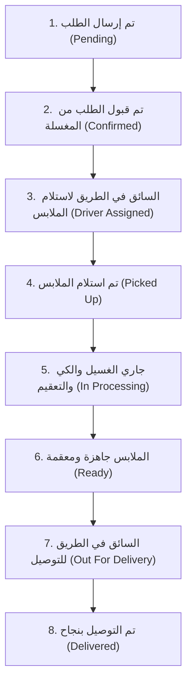

# دليل المعمارية القياسي لتطبيق جوال العميل (Flutter Architectural Guide)
## Customer Mobile App - Production Clean Architecture Guide

تم تصميم هذا الدليل ليكون المرجع الهندسي الرسمي لبناء وتطوير تطبيق جوال العميل (**Customer Mobile App**) التابع لمنظومة **LaundrySaaS**.

---

## 1. الفلسفة المعمارية العامة (Architecture Philosophy)

يعتمد تطبيق العميل على معمارية **الهيكلية القائمة على الميزات (Feature-First Architecture)** المدمجة مع مبادئ **Clean Architecture**.

### الأهداف الأساسية للمعمارية:
1. **تجربة مستخدم سريعة وسلسة (Seamless Customer UX)**: فصل واجهات العرض السريعة (تصفح، سلة، تتبع) عن منطق الشبكة والاتصال بالخادم.
2. **الفصل التام للمسؤوليات (Separation of Concerns)**: عزل واجهة المستخدم عن منطق الأعمال، وعزل منطق الأعمال عن مصادر البيانات والـ API.
3. **سهولة الصيانة والتوسع (Scalability & Maintainability)**: كل ميزة (`feature`) تعمل كوحدة مستقلة بذاتها، مما يتيح إضافة بوابات دفع جديدة أو ميزات حجز دون المساس بالميزات الأخرى.
4. **قابلية الاختبار (Testability)**: مرونة كتابة اختبارات الوحدة (`Unit Tests`) واختبارات الواجهات (`Widget Tests`).
5. **التكامل التام مع منصة ABP Framework**: دعم التعامل مع المستأجرين المتعددين (`Multi-Tenancy`)، والمصادقة الموحدة عبر توكن الـ JWT، وتحديد نطاق المغاسل والخدمات.

---

## 2. الهيكل الهرمي للمجلدات (Directory Structure)

```text
lib/
├── main.dart                   # نقطة الانطلاق وتهيئة الخدمات الأساسية
├── app.dart                    # تكوين MaterialApp، اللغات، الثيم، والموجه العام
│
├── config/                     # التهيئات العامة للتطبيق
│   ├── routes/                 # نظام التنقل والروابط العميقة (AppRoutes / GoRouter)
│   ├── theme/                  # ثيم Material 3، الألوان الموجهة للعملاء، خط Cairo
│   └── env.dart                # عناوين خوادم الـ API والـ AuthServer
│
├── core/                       # النواة المشتركة لكامل المشروع
│   ├── api/                    # عميل الشبكة الموحد (Dio Client)
│   │   ├── api_client.dart     # إعدادات Dio والمهل الزمنية
│   │   ├── api_endpoints.dart  # عناوين الـ Endpoints (المغاسل، الطلبات، العناوين)
│   │   ├── api_interceptor.dart# حقن التوكن، واللغة ar/en، و __tenant
│   │   └── api_exceptions.dart # معالجة أخطاء الشبكة والـ 401 والـ 500
│   ├── constants/              # ثوابت التطبيق (الألوان، المقاسات، مسارات الصور والأيقونات)
│   ├── errors/                 # فئات الأخطاء والإخفاقات (Failures & Exceptions)
│   ├── network/                # فحص ومراقبة حالة الاتصال بالإنترنت (NetworkInfo)
│   ├── storage/                # التخزين الآمن والمحلي (FlutterSecureStorage, SharedPreferences)
│   └── utils/                  # الأدوات المساعدة (تنسيق العملة ر.س، محددات التاريخ، الفالييداتورز)
│
├── features/                   # ميزات التطبيق (مقسمة بنمط Feature-First)
│   ├── auth/                   # المصادقة والحساب
│   │   ├── data/               # نماذج الطلب والاستجابة، Remote Auth DataSource
│   │   ├── domain/             # كيانات المستخدم (CustomerUser)، عقود المستودعات
│   │   └── presentation/       # شاشات الدخول، التسجيل الجديد، كود التحقق OTP
│   │
│   ├── home/                   # الصفحة الرئيسية واستعراض المغاسل
│   │   ├── data/               # نماذج المغاسل القريبة، العروض، التصنيفات
│   │   ├── domain/             # كيانات المغسلة (LaundryEntity)، تقييمات المغسلة
│   │   └── presentation/       # HomeScreen، بطاقات المغاسل، شريط البحث، الفلاتر
│   │
│   ├── catalog/                # استعراض خدمات المغسلة وأسعارها
│   │   ├── data/               # نماذج الخدمات (ServiceItemDto, CategoryDto)
│   │   ├── domain/             # كيانات الخدمات وقوائم الأسعار
│   │   └── presentation/       # LaundryCatalogScreen، بطاقة الخدمة، زر الإضافة للسلة
│   │
│   ├── cart/                   # سلة الطلب وحساب الأسعار
│   │   ├── data/               # كاش السلة المحلي والـ CartItem Models
│   │   ├── domain/             # CartEntity، حاسبة المجموع والضريبة
│   │   └── presentation/       # CartScreen، تعديل الكميات، الملاحظات الخاصة
│   │
│   ├── checkout/               # إتمام الطلب والدفع
│   │   ├── data/               # نماذج إنشاء الطلب (CreateOrderDto)، معالجة الدفع
│   │   ├── domain/             # خيارات الاستلام، بوابات الدفع (مدى، بطاقة، عند الاستلام)
│   │   └── presentation/       # CheckoutScreen، اختيار وقت الاستلام والتوصيل، تأكيد الطلب
│   │
│   ├── orders/                 # تتبع وإدارة طلبات العميل
│   │   ├── data/               # نماذج الطلب وتفاصيل الفاتورة وتحديثات الحالة
│   │   ├── domain/             # كيان الطلب (OrderEntity)، حالات دورة الغسيل
│   │   └── presentation/       # OrdersListScreen، شاشة التتبع المباشر LiveTrackScreen
│   │
│   ├── addresses/              # إدارة عناوين التوصيل للعميل
│   │   ├── data/               # نماذج العناوين وإحداثيات الخريطة
│   │   ├── domain/             # كيان العنوان (AddressEntity)
│   │   └── presentation/       # AddressesListScreen، شاشة تحديد الموقع على الخريطة
│   │
│   └── profile/                # الملف الشخصي والإعدادات والمحفظة
│       ├── data/               # نماذج الملف الشخصي، رصيد المحفظة
│       ├── domain/             # كيان العميل والمحفظة
│       └── presentation/       # ProfileScreen، WalletScreen، مركز المساعدة، تغيير اللغة
│
├── shared/                     # العناصر المشتركة القابلة لإعادة الاستخدام
│   └── widgets/                # أزرار التطبيق، حقول الإدخال، بطاقات العرض، شارات الحالة
│       ├── app_button.dart
│       ├── app_text_field.dart
│       ├── status_badge.dart
│       ├── empty_state_view.dart
│       └── loading_overlay.dart
│
└── l10n/                       # ملفات الترجمة والتعريب (RTL First)
    ├── app_ar.arb              # العربية (اللغة الافتراضية)
    └── app_en.arb              # الإنجليزية
```

---

## 3. تفصيل طبقات كل ميزة (Clean Architecture Inside Features)

كل مجلد داخل `features/` يتبع بدقة التقسيم ثلاثي الطبقات:

```
┌─────────────────────────────────────────────────────────────┐
│                    PRESENTATION LAYER                       │
│  - Screens: واجهات المستخدم الكاملة للتطبيق                 │
│  - Widgets: عناصر الواجهة المخصصة لكل ميزة                  │
│  - Controllers / Notifiers: إدارة حالة الواجهة والتفاعل     │
└──────────────────────────────┬──────────────────────────────┘
                               │  تعتمد على
                               ▼
┌─────────────────────────────────────────────────────────────┐
│                       DOMAIN LAYER                          │
│  - Entities: كائنات الأعمال النقية للعميل                   │
│  - Repository Interfaces: العقود والواجهات المجردة          │
│  - Use Cases / Calculations: منطق حساب الخصومات والضرائب    │
└──────────────────────────────▲──────────────────────────────┘
                               │  تنفذ عقودها
                               │
┌─────────────────────────────────────────────────────────────┐
│                        DATA LAYER                           │
│  - Models / DTOs: نماذج تسلسل وتفكيك الـ JSON مع الـ API     │
│  - Data Sources: جلب البيانات عبر Dio أو التخزين المحلي     │
│  - Repositories: تطبيق العقود واسترجاع البيانات             │
└─────────────────────────────────────────────────────────────┘
```

---

## 4. استراتيجية إدارة الحالة (State Management Strategy)

* **الخيار المعتمد**: **Provider مع ChangeNotifier** (أو **Riverpod** حسب التفضيل).
* **المبادئ الصارمة**:
  1. **عزل منطق الأعمال تماماً عن دوال `build()`**: الشاشات والـ Widgets تقوم فقط بالعرض والاستماع للحالة.
  2. **دورة حياة الحالة الأربع القياسية**:
     - `Initial`: الحالة الابتدائية قبل طلب البيانات.
     - `Loading`: جاري تحميل البيانات (عرض Shimmer / Skeleton Loading عصري).
     - `Success(data)`: اكتمال جلب البيانات بنجاح وعرض المحتوى.
     - `Error(message)`: إخفاق في العملية مع عرض رسالة مفهومة وزر إعادة المحاولة.

---

## 5. طبقة الشبكة والتكامل مع ABP Framework (Networking & Multi-Tenancy)

يتواصل تطبيق العميل مع خدمات الباك إند المركزية المبنية على **ABP Framework**:

### ترويسات الطلب الإلزامية في كل Request:
```http
Authorization: Bearer <JWT_ACCESS_TOKEN>
__tenant: <TENANT_ID_OR_NAME>
Accept-Language: ar
Content-Type: application/json
```

### معالجة الجلسة والأخطاء:
1. **401 Unauthorized**: انتهاء صلاحية الجلسة أو التوكن ➜ إعادة التوجيه لشاشة تسجيل الدخول تلقائياً مع تنبيه المستخدم.
2. **انقطاع الاتصال (Offline State)**: عرض شريط تنبيه لطيف مع دعم حفظ السلة محلياً لاستكمال الطلب فور عودة الشبكة.
3. **تعدد المغاسل**: دعم تحديد معرّف المغسلة ومستأجرها تلقائياً عند إضافة عناصر للطلب.

---

## 6. التعريب ونظام التصميم وتجربة المستخدم (Design System & UX)

* **الاتجاه واللغة**: **العربية (RTL - Right to Left)** كلغة أساسية وافتراضية.
* **الخط المعتمد**: **Cairo Font** لضمان وضوح الأرقام والأسعار واللغة العربية.
* **لوحة الألوان الموجهة للعملاء (Customer Brand Palette)**:
  - **اللون الأساسي (`Primary`)**: أزرق بحري نظيف وجذاب `#0284c7` و `#0369a1` يعكس النظافة والانتعاش.
  - **اللون الثانوي (`Secondary`)**: فيروزي منعش `#06b6d4` ونيلي راقي `#1e293b`.
  - **لون التأكيد والنجاح (`Success`)**: أخضر زمردي نضر `#10b981` لإتمام الدفع وتأكيد الحجز.
  - **ألوان الإشعارات والتنبيه (`Warning / Promo`)**: برتقالي حيوي `#f59e0b` للعروض والخصومات.
  - **الخلفيات والبطاقات**: أبيض ناصع `#ffffff` مع خلفية عامة `#f8fafc` وحواف دائرية عصرية (Border Radius 16-20px) وظلال ناعمة.

---

## 7. دورة حياة طلب العميل وتتبعه المباشر (Order Tracking Lifecycle)

تتوافق مراحل التتبع المعروضة للعميل مع حالات الباك إند:



---

## 8. معايير تسمية الملفات وهندسة الكود (Naming Conventions)

| المكون | نمط التسمية | مثال |
| :--- | :--- | :--- |
| **الشاشات الرئيسية** | `*_screen.dart` | `laundry_details_screen.dart` |
| **العناصر والودجات** | `*_widget.dart` / `*_card.dart` | `laundry_card.dart` |
| **النماذج والـ DTOs** | `*_model.dart` / `*_dto.dart` | `customer_order_dto.dart` |
| **إدارة الحالة والتحكم** | `*_controller.dart` | `cart_controller.dart` |
| **المستودعات ومصادر البيانات**| `*_repository.dart` / `*_datasource.dart` | `laundries_repository.dart` |
| **الأدوات والمساعدات** | `*_utils.dart` / `*_helper.dart` | `price_calculator.dart` |

---

## 9. قائمة الحزم المعتمدة للمشروع (Recommended Pubspec Dependencies)

- **الشبكة والمصادقة**: `dio`, `connectivity_plus`, `http`
- **إدارة الحالة**: `provider` (أو `flutter_riverpod`)
- **التخزين الآمن**: `flutter_secure_storage`, `shared_preferences`
- **الواجهات والتصميم**: `google_fonts`, `flutter_svg`, `lucide_icons`
- **الموقع والخرائط**: `geolocator`, `google_maps_flutter`
- **التعريب والتواريخ**: `intl`, `flutter_localizations`
- **الإشعارات وتحديثات الطلب**: `firebase_core`, `firebase_messaging`
