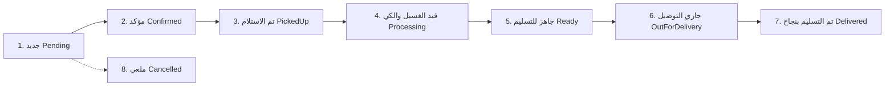

# دليل المعمارية القياسي لتطبيق جوال المغسلة (Flutter Architectural Guide)
## Laundry Mobile App - Production Clean Architecture Guide

تم تصميم هذا الدليل ليكون المرجع الهندسي الرسمي لبناء وتطوير تطبيق جوال المغسلة (**Laundry Operator & POS Mobile App**) التابع لمنظومة **LaundrySaaS**.

---

## 1. الفلسفة المعمارية العامة (Architecture Philosophy)

يعتمد التطبيق على معمارية **الهيكلية القائمة على الميزات (Feature-First Architecture)** المدمجة مع مبادئ **Clean Architecture**.

### الأهداف الأساسية للمعمارية:
1. **الفصل التام للمسؤوليات (Separation of Concerns)**: عزل واجهة المستخدم عن منطق الأعمال، وعزل منطق الأعمال عن مصادر البيانات والشبكة.
2. **سهولة الصيانة والتوسع (Scalability & Maintainability)**: كل ميزة (`feature`) تعمل كوحدة مستقلة بذاتها، مما يسهل إضافة ميزات جديدة أو تعديل ميزة قائمة دون التأثير على بقية التطبيق.
3. **قابلية الاختبار (Testability)**: سهولة كتابة اختبارات الوحدة (`Unit Tests`) واختبارات الواجهة (`Widget Tests`) بفضل حقن التبعيات (`Dependency Injection`).
4. **التوافق التام مع ABP Framework و Multi-Tenancy**: سهولة تمرير معرف المستأجر (`__tenant`) والتوكن الأمني في كافة الطلبات.

---

## 2. الهيكل الهرمي للمجلدات (Directory Structure)

```text
lib/
├── main.dart                   # نقطة الانطلاق وتهيئة الخدمات
├── app.dart                    # تكوين التطبيق، السمة، اللغات، والتوجيه
│
├── config/                     # التهيئات العامة
│   ├── routes/                 # نظام التنقل والتوجيه (AppRoutes / GoRouter)
│   ├── theme/                  # ثيم Material 3، الألوان، الخطوط (Cairo)
│   └── env.dart                # عناوين الخوادم والمتغيرات البيئية
│
├── core/                       # النواة المشتركة لكامل التطبيق
│   ├── api/                    # عميل الشبكة (Dio Client)
│   │   ├── api_client.dart     # إعدادات Dio المركزية
│   │   ├── api_endpoints.dart  # مسارات الـ Endpoints
│   │   ├── api_interceptor.dart# حقن التوكن ومعرف المستأجر (__tenant)
│   │   └── api_exceptions.dart # معالجة أخطاء الشبكة والـ 401 والـ 500
│   ├── constants/              # الثوابت (AppColors, AppDimensions, AppAssets)
│   ├── errors/                 # فئات الأخطاء والإخفاقات (Failures)
│   ├── network/                # مراقبة الاتصال بالإنترنت (NetworkInfo)
│   ├── storage/                # التخزين المحلي الآمن (Secure Storage & SharedPrefs)
│   └── utils/                  # أدوات المساعدة (التواريخ، العملة ر.س، الفالييداتورز)
│
├── features/                   # ميزات التطبيق (مقسمة Feature-First)
│   ├── auth/                   # المصادقة وتسجيل الدخول
│   │   ├── data/               # نماذج البيانات والاتصال بالخادم
│   │   │   ├── datasources/    # Remote Auth DataSource
│   │   │   ├── models/         # LoginRequest, AuthResponse, UserDto
│   │   │   └── repositories/   # AuthRepositoryImpl
│   │   ├── domain/             # منطق الأعمال والواجهات
│   │   │   ├── entities/       # UserEntity, TenantEntity
│   │   │   └── repositories/   # IAuthRepository
│   │   └── presentation/       # واجهات المستخدم وإدارة الحالة
│   │       ├── controllers/    # AuthController / AuthNotifier
│   │       ├── screens/        # LoginScreen, SplashScreen
│   │       └── widgets/        # LoginForm, TenantSelectorField
│   │
│   ├── dashboard/              # لوحة المؤشرات والإحصائيات السريعة
│   │   ├── data/
│   │   ├── domain/
│   │   └── presentation/       # DashboardScreen, KpiCard, QuickActionFab
│   │
│   ├── orders/                 # إدارة الطلبات ودورة حياة الغسيل
│   │   ├── data/               # OrderModels, OrderApiDataSource
│   │   ├── domain/             # OrderEntity, OrderStatus, UseCases
│   │   └── presentation/       # OrdersListScreen, OrderDetailsScreen, StatusTimeline
│   │
│   ├── pos/                    # نقطة البيع السريعة للعملاء المباشرين (Walk-in)
│   │   ├── data/               # CreateOrderRequest, CartItemModel
│   │   ├── domain/             # CartEntity, PricingCalculator
│   │   └── presentation/       # PosScreen, ItemCounter, ReceiptPreviewModal
│   │
│   ├── catalog/                # كتالوج الخدمات وقوائم الأسعار
│   │   ├── data/               # CategoryDto, ServiceItemDto
│   │   ├── domain/             # ServiceItemEntity, CategoryEntity
│   │   └── presentation/       # CatalogScreen, ItemPriceEditSheet
│   │
│   └── settings/               # إعدادات المغسلة والملف الشخصي
│       ├── presentation/       # ProfileScreen, LanguageToggle, PrinterConfigScreen
│
├── shared/                     # المكونات والعناصر المشتركة بين الميزات
│   └── widgets/                # أزرار مخصصة، حقول إدخال، شارات الحالة، بطاقات
│       ├── app_button.dart
│       ├── app_text_field.dart
│       ├── status_badge.dart
│       ├── stat_card.dart
│       ├── empty_state_view.dart
│       └── loading_overlay.dart
│
└── l10n/                       # التعريب والترجمة (RTL First)
    ├── app_ar.arb              # النصوص العربية (الافتراضية)
    └── app_en.arb              # النصوص الإنجليزية
```

---

## 3. تفصيل طبقات كل ميزة (Clean Architecture Layers Inside Features)

كل مجلد داخل `features/` يتبع بدقة التقسيم ثلاثي الطبقات:

```
┌─────────────────────────────────────────────────────────────┐
│                    PRESENTATION LAYER                       │
│  - Screens (واجهات المستخدم الكاملة)                         │
│  - Widgets (عناصر الواجهة الجزئية الخاصة بالميزة)            │
│  - State Notifiers / Controllers (إدارة حالة الواجهة)       │
└──────────────────────────────┬──────────────────────────────┘
                               │  تعتمد على
                               ▼
┌─────────────────────────────────────────────────────────────┐
│                       DOMAIN LAYER                          │
│  - Entities (كائنات البيانات النقية المستقلة عن أي إطار عمل) │
│  - Repository Interfaces (العقود المجردة للوصول للبيانات)   │
│  - Business Rules / Calculators (منطق الحسابات والضريبة)     │
└──────────────────────────────▲──────────────────────────────┘
                               │  تنفذ عقودها
                               │
┌─────────────────────────────────────────────────────────────┐
│                        DATA LAYER                           │
│  - DTOs / Models (نماذج مع تسلسل JSON وتوافق الباك إند)     │
│  - Data Sources (Remote API عبر Dio & Local Cache)          │
│  - Repository Implementations (تنفيذ العقود واستدعاء الـAPI) │
└─────────────────────────────────────────────────────────────┘
```

---

## 4. استراتيجية إدارة الحالة (State Management Strategy)

* **الخيار الموصى به للمشروع**: **Riverpod** أو **Provider مع ChangeNotifier**.
* **المبادئ المتبعة**:
  1. **عدم وضع أي منطق برمجي داخل الـ `build()`**: جميع الاستدعاءات والتحويلات تجري داخل الـ `Controller / Notifier`.
  2. **إدارة الحالات الأربع للواجهة**:
     - `Initial`: الحالة الابتدائية.
     - `Loading`: جاري جلب البيانات من الخادم (عرض مؤشر التحميل Skeleton/Spinner).
     - `Success(data)`: تم استرجاع البيانات بنجاح وعرض المحتوى.
     - `Error(message)`: حدث خطأ (عرض رسالة واضحة مع زر إعادة المحاولة Retry).

---

## 5. طبقة الشبكة والتكامل مع ABP Framework (Networking & Multi-Tenancy)

تطبيق المغسلة يعمل مع باك إند **ABP Framework** متعدد المستأجرين، ولذلك يتبع نظام اعتراض الطلبات (`Dio Interceptors`) الآتي:

### ترويسات الطلب الإلزامية في كل Request:
```http
Authorization: Bearer <JWT_ACCESS_TOKEN>
__tenant: <TENANT_ID_OR_NAME>
Accept-Language: ar
Content-Type: application/json
```

### معالجة رمز الدخول والأخطاء المركزية:
1. **401 Unauthorized**: مسح التوكن من التخزين الآمن وإعادة توجيه المستخدم تلقائياً لشاشة تسجيل الدخول (`LoginScreen`).
2. **403 Forbidden**: عرض تنبيه بعدم وجود صلاحية للموظف.
3. **انقطاع الإنترنت**: عرض تنبيه اتصال بالشبكة مع الحفاظ على البيانات المؤقتة محلياً.

---

## 6. التعريب والاتجاه ونظام التصميم (Localization & UI Design System)

* **اللغة الأساسية والافتراضية**: **العربية (RTL - Right to Left)**.
* **الخط المعتمد**: **Cairo Font** من Google Fonts (لتوحيد الهوية البصرية مع لوحة التحكم الويب).
* **نظام الألوان الرسمي**:
  - اللون الأساسي (`Primary`): كحلي فاخر وأزرق داكن `#0f172a` و `#0284c7`.
  - اللون المساعد (`Accent / Success`): الأخضر الزمردي `#10b981` (للطلبات الجاهزة والإيرادات).
  - لون التحذير (`Warning`): البرتقالي `#f59e0b` (للطلبات قيد الغسيل والكي).
  - خلفيات البطاقات: درجات الرمادي الفاتح `#f8fafc` مع حواف ناعمة بقطر 12-16px وظلال لطيفة.

---

## 7. حالات دورة حياة الطلب داخل التطبيق (Order Workflow Transitions)

يتم تمثيل حالات الطلب بتوافق تام مع `OrderStatus` في الباك إند:



---

## 8. معايير تسمية الملفات والكود النظيف (Naming Conventions)

| العنصر | التسمية القياسية | مثال |
| :--- | :--- | :--- |
| **ملفات الشاشات** | `*_screen.dart` | `orders_list_screen.dart` |
| **ملفات العناصر الجزئية** | `*_widget.dart` أو `*_card.dart` | `order_card_widget.dart` |
| **ملفات النماذج والـ DTOs** | `*_model.dart` أو `*_dto.dart` | `order_model.dart` |
| **ملفات إدارة الحالة** | `*_controller.dart` أو `*_notifier.dart` | `orders_controller.dart` |
| **ملفات المستودعات** | `*_repository.dart` | `order_repository.dart` |
| **ملفات الأدوات المساعدة** | `*_utils.dart` أو `*_formatter.dart` | `currency_formatter.dart` |

---

## 9. قائمة الحزم المعتمدة في `pubspec.yaml` (Core Dependencies)

- **الشبكة والاتصال**: `dio`, `connectivity_plus`
- **إدارة الحالة**: `provider` (أو `flutter_riverpod`)
- **التخزين الآمن**: `flutter_secure_storage`, `shared_preferences`
- **التصميم والخطوط**: `google_fonts`, `flutter_svg`, `lucide_icons`
- **التواريخ والعملات**: `intl`, `flutter_localizations`
- **الباركود والطباعة**: `qr_flutter`, `mobile_scanner`, `blue_thermal_printer` / `esc_pos_utils`
